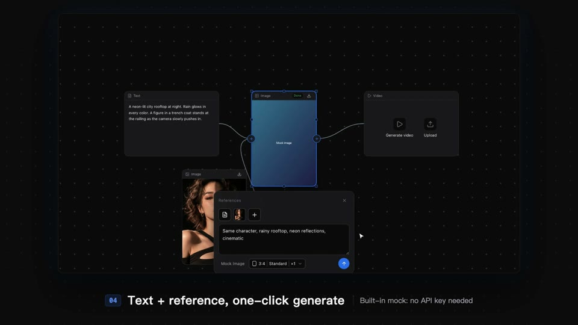
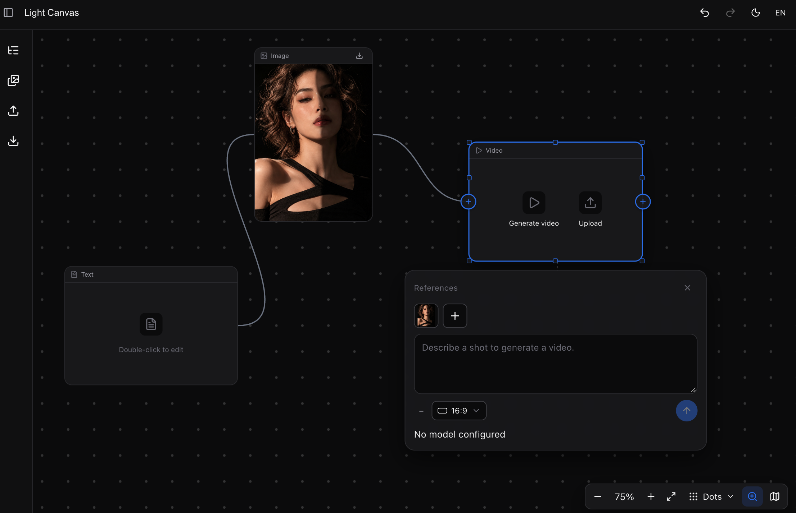

<p align="center">
  
</p>

<h1 align="center">Light Canvas</h1>

<p align="center">A lightweight, embeddable React infinite canvas for connecting text, image, and video nodes.</p>

<p align="center">
  <a href="https://hongye007.github.io/light-canvas/">Try the demo</a> · <a href="https://www.npmjs.com/package/@infranic/light-canvas">npm package</a> · <a href="README.zh-CN.md">简体中文</a>
</p>

## Promo video

[](https://github.com/hongye007/light-canvas/releases/download/v0.2.1/light-canvas-promo-en-bgm.mp4)

[Watch the promo · 37 seconds](https://github.com/hongye007/light-canvas/releases/download/v0.2.1/light-canvas-promo-en-bgm.mp4)

## Live demo

[Open the Light Canvas demo](https://hongye007.github.io/light-canvas/) to connect nodes, add references, and try mock image and text generation. The demo runs in the browser without an API key.

[](https://hongye007.github.io/light-canvas/)

## Built with Light Canvas

OpenWeGo is an AI creative toolkit for generating and editing images and refining prompts. Its Infinite Canvas uses Light Canvas to connect prompts, reference media, and generation results in a visual workflow. [Open the OpenWeGo Infinite Canvas](https://openwego.com/tools/infinite-canvas)

## Install the React component

Install the public package in your React project.

```bash
npm install @infranic/light-canvas
```

To build a tarball from source, run `pnpm pack:canvas`. Release archives are also available from the repository's Releases page.

The ESM package includes JavaScript, TypeScript declarations, and a CSS entry point. A minimal React host can start with the bundled mock producer.

```tsx
import { LightCanvas, createMockProducer } from "@infranic/light-canvas";
import "@infranic/light-canvas/styles.css";

const config = {
    producer: createMockProducer(),
    models: [
        { id: "mock-text", label: "Mock Text", capabilities: ["text"] as ["text"] },
        { id: "mock-image", label: "Mock Image", capabilities: ["image"] as ["image"] },
    ],
};

export function Workspace() {
    return (
        <div style={{ position: "relative", height: "80vh" }}>
            <LightCanvas config={config} locale={{ lang: "en-US" }} theme={{ mode: "dark" }} />
        </div>
    );
}
```

For live generation, inject your own `CanvasProducer` and model list. The generic `createOpenAICompatibleProducer` adapter uses your backend's image generation, image edit, and chat completion endpoints. The host can supply a video implementation through `CanvasProducer.generate`. Video-to-text in the generic adapter analyzes sampled frames.

Use `onDocumentChange` to persist the document, `initialDocument` to load it, and `NodeRegistry` to add custom React node renderers.

## Use the canvas

- Double-click empty canvas space to add a text, image, video, or group node. Double-click a text card to edit it directly.
- Drag from one node's port to another to connect them. Drop images into the prompt area or use its add button to create linked references. Image and video nodes support five incoming attachments.
- Drag a node fully inside a group to join it. Groups can arrange their members in a grid, row, or column.
- Use the left rail to find nodes, browse images, or import and export canvas JSON.
- Use the lower-right toolbar for zoom, fit, canvas backgrounds, and the minimap.
- Type `@` in a prompt to pick a linked or available node. At generation time, each node reads only its direct connections.
- Open the media settings button to change aspect ratio and other settings exposed by the selected model. The aspect ratio is saved per node.
- Hover over a media card to see thumbnails from the latest generation batch. Use the history button in the card header to preview earlier generation batches, set an earlier result as the active output, or copy it into a new node.

| Action | Shortcut |
| --- | --- |
| Pan | Scroll, Space + drag, or middle-button drag |
| Select several nodes | Drag on blank canvas; hold Shift to add to the selection |
| Zoom around the cursor | Ctrl / Cmd + scroll |
| Search nodes | Ctrl / Cmd + K |
| Copy / paste / duplicate | Ctrl / Cmd + C / V / D |
| Undo / redo | Ctrl / Cmd + Z / Shift + Z |
| Group / ungroup | Ctrl / Cmd + G / Shift + G |
| Delete | Delete or Backspace |
| Fit canvas | Ctrl / Cmd + 0 |

The workspace stores uploaded media in the browser's IndexedDB and restores it after reload. The local image library keeps uploaded images and archives generated images when their bytes can be downloaded. If a provider blocks that download, the library retains the image URL. JSON exports preserve asset references. Moving the JSON to another browser does not transfer locally stored files.

## Run the workspace

Requires Node.js 22.12 or later and pnpm 9.

```bash
pnpm install --frozen-lockfile
pnpm dev
```

Open the local URL shown by Vite. The demo ships with mock image and text generation and browser-local media storage. Change the port with `MAXFLOW_PORT=5205 pnpm dev`.

## Run the optional backend

The packaged React component still accepts any implementation of `CanvasProducer`. The optional Node server serves the demo and exposes a provider-neutral task API. It keeps credentials server-side and includes adapters for compatible chat, image generation and editing, and asynchronous video endpoints.

From source, run `pnpm build` and `pnpm start`. From the standalone backend archive, extract it and run `node --env-file-if-exists=.env server/index.mjs` with Node 22.12 or later. It opens at `http://127.0.0.1:5210` by default. Copy `.env.example` to `.env`, set the compatible API base URL, key and model IDs, and restart. Without a configured model, the demo uses mock generation. For a remote deployment, set `MAXFLOW_ACCESS_PASSWORD` and use HTTPS through a reverse proxy.

The demo submits tasks through `POST /api/tasks`, checks progress with `GET /api/tasks/:id`, and fetches completed media from the returned asset URLs. Task state lives in memory and result URLs expire after 15 minutes. Install FFmpeg on the server if you use video-to-text frame sampling.

## Configure workspace visibility

Use the `shell` prop to hide individual controls while keeping the rest of the workspace.

```tsx
<LightCanvas
    config={config}
    shell={{
        showTitle: false,
        showHistory: false,
        showThemeToggle: false,
        showLanguageToggle: false,
        showAssets: false,
        showImport: false,
        showExport: false,
        showSettings: false,
    }}
/>
```

Use `showUndo` and `showRedo` to hide history buttons individually, and `showNodes` to hide the node list. Set `topBar` or `rail` to `false` to hide an entire area. `minimap` and `zoomControls` control the bottom canvas tools. Hiding a button leaves its keyboard shortcuts available.

Set `config.defaultModels` to choose defaults per node type. Use `config.renderSettings` to supply your own settings view. Model IDs and default selections supplied to the component are visible to its browser users. Store API credentials on your backend and inject an authenticated producer or adapter.


The demo uses this hook to show its generation mode and available models. The canvas owns the settings button and dialog, and the host supplies the dialog contents. The button appears when the settings control is enabled and a render callback is provided.

## Development checks

```bash
pnpm typecheck
pnpm build
pnpm pack:canvas
```

- `packages/canvas` contains the reusable component and provider contracts.
- `apps/demo` contains the mock workspace and browser persistence.
- [Architecture notes](docs/architecture.md) describe the original design. [Release checklist](docs/release-checklist.md) records the current scope.

## License

[MIT](LICENSE)
