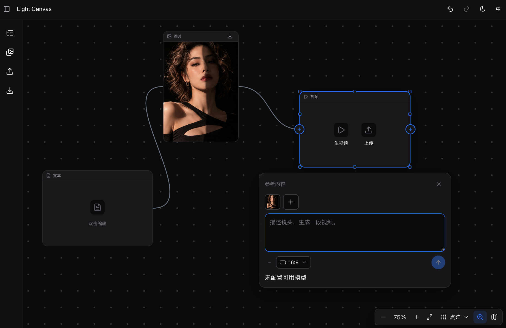

<p align="center">
  
</p>

<h1 align="center">Light Canvas</h1>

<p align="center">开箱即用的轻量无限画布，可嵌入 React 项目，把文本、图片和视频连成工作流。</p>

<p align="center">
  <a href="https://hongye007.github.io/light-canvas/">在线演示</a> · <a href="https://www.npmjs.com/package/@infranic/light-canvas">npm 安装包</a> · <a href="README.md">English</a>
</p>

## 在线演示

[打开 Light Canvas 演示](https://hongye007.github.io/light-canvas/)，可以连线、添加参考素材，以及体验模拟文生图和文本生成。演示直接在浏览器运行，无需 API 密钥。

[](https://hongye007.github.io/light-canvas/)

[观看演示视频](https://youtu.be/HyWiI4yi5Bg)

## 集成案例

OpenWeGo 是一个 AI 创作灵感和工具平台，提供完全免费的图片生成、图片编辑和提示词优化。它的自由画布用 Light Canvas 把提示词、参考素材和生成结果连成可视化工作流。[体验 OpenWeGo 自由画布](https://openwego.com/tools/infinite-canvas)

## 安装 React 组件

在 React 项目中安装 npm 包。

```bash
npm install @infranic/light-canvas
```

从 `@infranic/light-canvas` 导入 `LightCanvas`，并引入 `@infranic/light-canvas/styles.css`。完整用法见 [React 接入示例](README.md#install-the-react-component)。

宿主可以通过 `shell` 逐项隐藏标题、撤销重做、主题、语言、节点列表、资产库、JSON 导入导出和设置。参数示例见 [界面可见性配置](README.md#configure-workspace-visibility)。

## 画布操作

- 双击空白处添加节点，双击文本节点编辑正文。
- 从端口拖线连接，也可将图片拖入提示词区自动创建参考节点。图片与视频节点最多接收五个附件。
- 节点完全拖入分组后加入分组，组内节点可按宫格、横向或纵向排列。
- 左栏支持搜索节点、查看本地资产、导入和导出 JSON。
- 上传文件保存在当前浏览器。导出的 JSON 保留资产引用，跨浏览器迁移时需另行复制本地文件。

画布提供设置按钮和弹窗，宿主通过 `config.renderSettings` 提供内容。公开 Demo 用这个接口展示生成方式和可用模型。启用设置控件并传入回调后，画布会显示设置按钮。

## 本地运行

需要 Node.js 22.12 或更高版本及 pnpm 9。

```bash
pnpm install --frozen-lockfile
pnpm dev
```

打开 Vite 显示的本地地址。示例使用模拟的文本和图片生成，支持本地媒体上传和保存。需要真实生成时，由宿主注入兼容的接口和模型配置。

## 启动可选后端

React 组件仍可通过 `CanvasProducer` 独立接入。随仓库提供的 Node 后端支持兼容的文本、图片生成、图片编辑和异步视频接口，API 密钥保存在服务端。

从源码运行 `pnpm build` 和 `pnpm start`。使用独立后端包时，解压后用 Node 22.12 或更新版本运行 `node --env-file-if-exists=.env server/index.mjs`。默认访问 `http://127.0.0.1:5210`。复制 `.env.example` 为 `.env`，填写 API 地址、密钥和模型后重启。未配置模型时，画布使用模拟生成。

后端统一提交任务、查询进度和返回结果。任务状态存于内存，结果下载地址保留 15 分钟。视频生文抽帧需要服务端安装 FFmpeg。

## 开发与打包

```bash
pnpm typecheck
pnpm build
pnpm pack:canvas
```

从源码打包会生成 `artifacts/infranic-light-canvas-0.2.0.tgz`。

## 许可证

[MIT](LICENSE)
